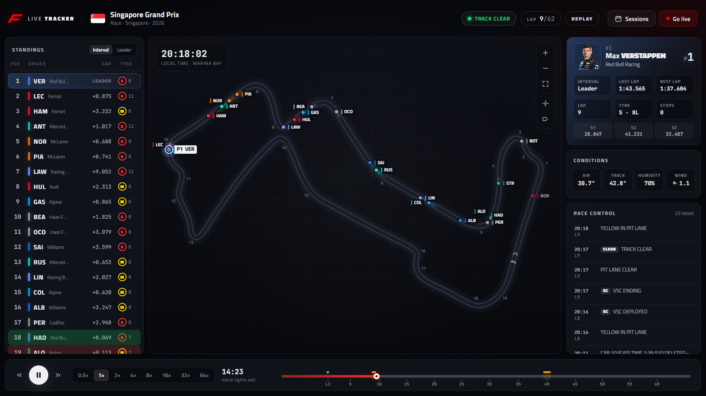

# F1 Live Track Positions

Watch every car move around the circuit, live during a session or as a replay of any session since 2023 at up to 64× speed. Runs on your own computer as a dark, browser-based dashboard. No account needed.



**What you get**

- **Track map:** cars in team colours with motion trails and driver labels that don't overlap. Yellow-flag sectors light up on the track, and the circuit glows amber under a Safety Car or VSC. Zoom, pan, and follow a single driver.
- **Standings tower:** interval or gap to leader, tyre compound and age, pit and retirement badges. Rows animate as positions change.
- **Driver card:** headshot, last and best lap, sector times, tyre, pit stops.
- **Race control feed and track conditions:** air and track temperature, humidity, wind, rain.
- **Timeline:** play, pause, 0.5×–64× speed, lap ticks, and coloured SC/VSC/red-flag periods.
- **Session picker:** every Grand Prix, Sprint, qualifying and practice session from 2023 onward, with what's live right now at the top.

---

## Getting started

You only need **Python 3.12 or newer** and an internet connection.

1. **Install Python** if you don't have it, from <https://www.python.org/downloads/>. On Windows, tick **"Add python.exe to PATH"** in the installer.
2. **Download this project** (the green *Code → Download ZIP* button on GitHub, or the zip you were sent) and unzip it anywhere.
3. **Start it:**

   | System | How |
   |---|---|
   | Windows | Double-click **`F1-Tracker-Windows.bat`** |
   | macOS | Double-click **`F1-Tracker-macOS.command`**. If macOS won't open it, open Terminal in the folder and run `python3 run_f1_tracker.py` |
   | Linux | Run `sh f1-tracker-linux.sh` in a terminal in the folder |
   | Any, from a terminal | `python run_f1_tracker.py` (or `python3 …`) |

The **first start takes about a minute**. The app creates its own private Python environment in a `.venv` folder inside the project and installs what it needs there. Your system Python and other projects are left alone. After that it starts in seconds.

Your browser opens the dashboard. It shows the live session if one is on and you've added an OpenF1 account (see below); otherwise it shows a replay of the latest race. **Close the browser tab to quit**; the app shuts itself down a few seconds later.

**To remove it completely, delete the folder.** Everything the app installs or saves lives inside it.

---

## Using it

**Switching sessions:** click **Choose race** (top right), the race name in the header, or the logo, or press `S`. The picker shows what's live right now at the top, and every session of every season below it.

Click a car on the map or a row in the standings to select a driver.

| Key | Action |
|---|---|
| `Space` | Play / pause |
| `←` / `→` | Back / forward 10 s (hold `Shift` for 1 min) |
| `↑` / `↓` | Faster / slower |
| `L` | Jump to the live edge |
| `S` | Choose a session |
| `F` | Follow the selected driver |
| `N` | Driver labels: all → selected → none |
| `+` / `-` / `0` | Zoom in / out / reset (or mouse wheel, drag to pan, double-click to reset) |
| `Esc` | Close dialog / deselect driver |

---

## Where the data comes from

| | Source | Cost |
|---|---|---|
| **Replays** of finished sessions | [OpenF1](https://openf1.org) | Free, no account. Data appears about 30–60 min after a session ends |
| **Live** car positions during a session | OpenF1 real-time feed | Needs an OpenF1 subscription (€9.90/month) |

**About live sessions:** while a session is live, from about 30 min before it starts until about 30 min after it ends, OpenF1 limits *all* its data to subscribers, past sessions included. Without an account the app shows a clear message and greys out what can't load during that window. Everything works again once it closes.

Other free sources were checked and don't help. F1's own feed only sends live car positions to F1 TV subscribers, and it blocks many networks. The community sites with live maps don't offer a public API.

### Optional: live tracking with an OpenF1 account

1. Get an account at <https://openf1.org>.
2. Copy `.env.example` to `.env` (in the project folder) and fill in `OPENF1_USERNAME` and `OPENF1_PASSWORD`.
3. Restart. The app goes live automatically whenever a session is on, or press **Watch live**.

Live mode renders a few seconds behind real time so cars move smoothly between position samples, and you can rewind and press **LIVE** to return.

---

## Settings

Put any of these in a `.env` file in the project folder. `.env.example` has a template.

| Setting | Default | |
|---|---|---|
| `OPENF1_USERNAME` / `OPENF1_PASSWORD` | – | OpenF1 account for live data (optional) |
| `F1TRACKER_KEEP_DATA` | off | `1` keeps downloaded sessions in `.cache/` for instant reopening (and replays during live-session lockouts). By default session data stays in memory and nothing is left on disk |
| `F1TRACKER_LIVE_DELAY` | `4` | Seconds the live view stays behind real time |
| `F1TRACKER_PORT` | `8050` | Port for the dashboard (the next free one is used if it's taken) |

Command-line options for `run_f1_tracker.py`:

| Option | |
|---|---|
| `--session 11388` | Open a specific OpenF1 `session_key` |
| `--live` | Start in live mode |
| `--port 8050` | Choose the port |
| `--no-browser` | Don't open a browser window |
| `--keep-running` | Don't quit when the browser tab is closed (Ctrl+C to stop) |
| `--debug` | Verbose logging |

---

## Troubleshooting

- **"Python isn't installed" / nothing happens on Windows:** install Python from python.org with "Add python.exe to PATH" ticked, then try again.
- **"This folder's location is too long for Windows":** move the folder somewhere shorter, such as `C:\F1-Live-Track-Positions` or your Downloads folder.
- **Setup failed halfway (e.g. internet dropped):** delete the `.venv` folder inside the project and start again.
- **Old Python:** the app needs Python 3.12 or newer and says so if yours is older.
- **The dashboard says "The tracker has stopped":** the app was closed. Start it again; the page reconnects by itself.

---

## For developers

```bash
python -m venv .venv && .venv/bin/pip install -r requirements-dev.txt   # Windows: .venv\Scripts\pip
python -m pytest                                  # offline test suite, a few seconds
F1TRACKER_NETWORK_TESTS=1 python -m pytest        # also hit the real OpenF1 API
python tools/make_zip.py                          # clean copy to share, as a zip and a folder
```

`tools/make_zip.py` writes `dist/F1-Live-Track-Positions.zip` and a matching folder `dist/F1-Live-Track-Positions/`. Both leave out `.env` (your password), `.venv`, `.cache` and other local files. Use it rather than zipping or uploading the project folder by hand. A conda `environment.yml` is included for those who prefer conda. In VS Code, open `run_f1_tracker.py` and press **Run ▷**.

### How it works

```
                 ┌──────────────────────────── data/ ────────────────────────────┐
 OpenF1 REST ───▶│ OpenF1Client (rate limit, retries, optional disk cache)        │
 OpenF1 MQTT ───▶│ OpenF1LiveFeed (paho thread → asyncio queue)                   │
 MultiViewer ───▶│ CircuitRepository (outline, corners, marshal sectors)          │
                 │ openf1_parse: rows → domain events (same code for REST & MQTT) │
                 └───────────────────────────────┬───────────────────────────────┘
                                                 ▼
                 ┌──────────────────────────── core/ ────────────────────────────┐
                 │ SessionData = TrajectoryStore (car positions, interpolated)    │
                 │             + EventLog (timing events, time-ordered)           │
                 │ PlaybackClock (replay or live edge + DVR)                      │
                 │ PlaybackEngine: every 50 ms → advance RaceState, emit frame    │
                 └───────────────────────────────┬───────────────────────────────┘
                                                 ▼ WebSocket (JSON)
                 ┌──────────────────────────── web/ ─────────────────────────────┐
                 │ Canvas track map (60 fps interpolation), standings, timeline  │
                 └───────────────────────────────────────────────────────────────┘
```

Replay and live share **one pipeline**. A replay loads a finished session into the same store that a live session fills message by message, so replays exercise exactly the code that runs during a live race. Race state is updated *last writer wins on the event timestamp*, so it doesn't depend on the order live messages arrive in.

```
run_f1_tracker.py           Entry point: first-run setup (.venv), server, browser
F1-Tracker-*.bat/.command/.sh   Double-click launchers
f1tracker/
  config.py                 Settings from environment / .env
  core/                     Source-agnostic logic: models, trajectories, event log,
                            race state, playback clock, session, engine
  data/                     OpenF1 client/parser/live feed, session loader,
                            circuits (MultiViewer), schedule, disk cache
  server/                   FastAPI app, session controller, WebSocket hub
  web/                      Front end (vanilla ES modules, no build step)
tests/                      pytest suite, offline, using a recorded slice of the 2026 Singapore GP
tools/make_zip.py           Builds the shareable zip and folder
```

---

## Notes

- Unofficial project, not associated with Formula 1, the FIA or any team. F1 and related marks belong to their owners.
- Data from [OpenF1](https://openf1.org) (free for personal use outside live sessions). Circuit layouts from [MultiViewer](https://multiviewer.app).
- Car positions arrive about 4 times a second; the app interpolates between them, so motion is smooth but not exact through corners.
